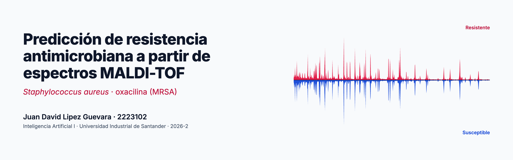

# Predicción de resistencia antimicrobiana a partir de espectros MALDI-TOF

Inteligencia Artificial I, 2026-2 · Universidad Industrial de Santander

## Objetivo

Predecir la resistencia a oxacilina de *Staphylococcus aureus* desde su espectro de masas, sin
esperar el antibiograma.

Identificar la especie toma minutos con MALDI-TOF, pero el antibiograma por cultivo tarda de 24 a
72 horas. La hipótesis es que el espectro ya trae la respuesta: la resistencia la da el gen `mecA`,
que produce una proteína, y MALDI-TOF mide proteínas.

## Dataset

DRIAMS: espectros MALDI-TOF con perfiles de resistencia confirmados por antibiograma.

* Descarga: https://www.kaggle.com/datasets/drscarlat/driams
* Artículo: [Weis et al., *Nature Medicine* (2022)](https://doi.org/10.1038/s41591-021-01619-9)

| | |
|---|---|
| Sitio usado | DRIAMS-A, Basilea, 2015 a 2018 |
| Muestras de *S. aureus* | 6.994 |
| Con antibiograma de oxacilina | 3.790, de 1.841 pacientes |
| Balance | 726 resistentes (19,2%), 3.064 susceptibles |
| Variables | 6.000 bins de intensidad, de 2.000 a 20.000 Da |

## Integrantes

| Nombre | Código |
|---|---|
| Juan David Lipez Guevara | 2223102 |

## Video

<!-- PENDIENTE: reemplazar por la URL de YouTube -->
`PENDIENTE`

## Estructura

```
├── mrsa_maldi_tof.ipynb    notebook acumulativo, las tres entregas
├── diapositivas.pdf        resumen del semestre
├── banner.png
├── prepare_data.py         extrae del zip de DRIAMS los datos de S. aureus
└── requirements.txt
```

| Secciones | Contenido |
|---|---|
| 1 a 10 | Motivación, dataset, limpieza, exploración, outliers con IQR |
| 11 a 19 | Particionado por paciente, DecisionTree, RandomForest, SVM, CrossValidation, perceptrón multicapa |
| 20 a 24 | Escalado, PCA, KMeans, DBSCAN |

## Resultados

Partición 80/20 por paciente, no por espectro: el 74% de los espectros vienen de pacientes con más
de una muestra, así que repartirlos al azar deja a la misma persona en entrenamiento y prueba.
Evaluación sobre 732 espectros nunca vistos, de los cuales 139 son resistentes.

| Modelo | accuracy | tpr | tnr | Resistentes hallados |
|---|---|---|---|---|
| DecisionTree (`max_depth=5`) | 0,829 | **0,626** | 0,877 | **87** de 139 |
| RandomForest (`n_estimators=5`) | 0,833 | 0,338 | 0,949 | 47 de 139 |
| SVM (`kernel=linear`) | 0,842 | 0,554 | 0,909 | 77 de 139 |
| Red neuronal (10 capas, 100 epochs) | **0,884** | 0,540 | **0,965** | 75 de 139 |

`tpr` es la proporción de resistentes detectados y `tnr` la de susceptibles. Contestar
*susceptible* siempre da 0,810 de accuracy con `tpr` en cero, así que la accuracy sola no sirve.

**El orden se invierte entre métricas.** La red gana en accuracy, pero el árbol encuentra 87
resistentes y la red 75. En un hospital el error caro es no detectar un MRSA, así que pesa el
`tpr`.

**El clustering no encuentra la resistencia.** Con PCA a 2 componentes, que recogen el 17,6% de la
varianza, KMeans parte el conjunto en dos grupos de 14,9% y 23,7% de resistentes, contra 19,2% del
conjunto completo. DBSCAN ve una sola nube.

La señal existe, pero no es la variación dominante del espectro. Por eso el problema necesita
aprendizaje supervisado.

## Reproducir

```bash
pip install -r requirements.txt
kaggle datasets download drscarlat/driams -p data/
python prepare_data.py
```

`prepare_data.py` produce `data/saureus_raw.csv` y `data/saureus_raw.npy`, que son los dos archivos
que lee el notebook. Los datos no están en el repositorio porque el zip pesa 8,2 GB.

Para correr en Colab basta subir esos dos archivos a Drive. La primera celda detecta el entorno y
monta la unidad.
